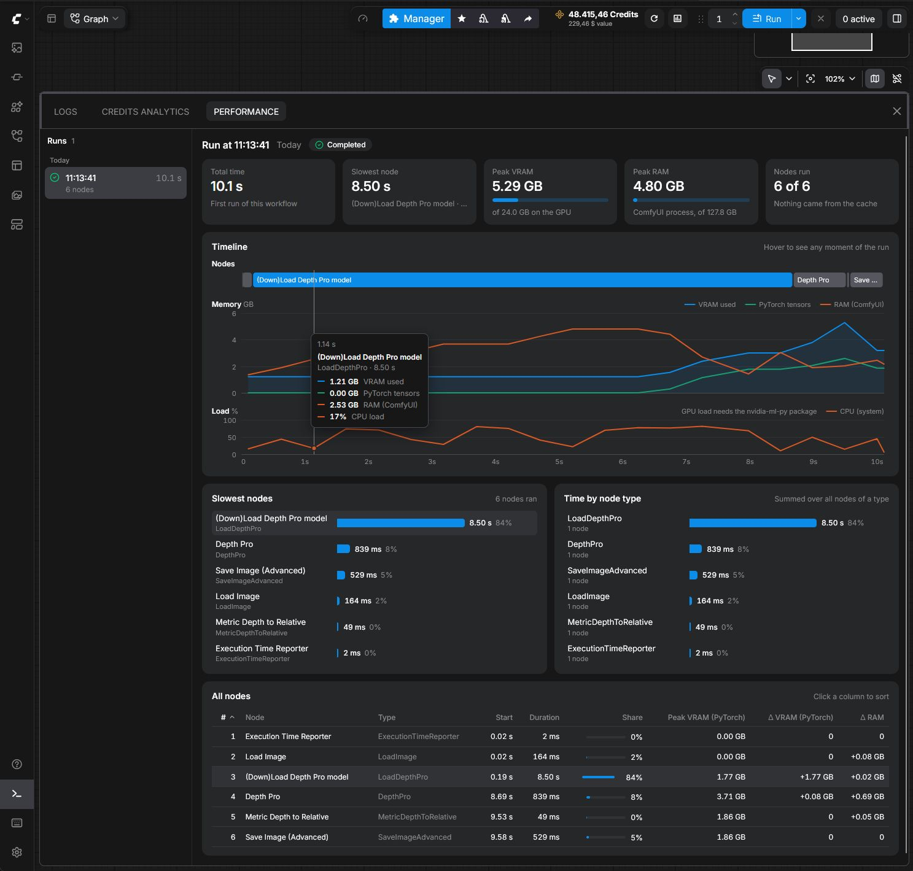

# ComfyUI Execution Time Reporter

Times every node in a ComfyUI workflow and records VRAM, RAM and CPU use while it runs. You see the results in a Performance tab inside ComfyUI, and the Execution Time Reporter node writes a text report you can keep or share.



## Installation

```bash
cd ComfyUI/custom_nodes/
git clone https://github.com/njlent/ComfyUI_performance-report
```

Restart ComfyUI. The plugin uses `psutil` and `torch`, which ComfyUI already installs. GPU load in the dashboard also needs `nvidia-ml-py`. On the Windows portable build, install it with `python_embeded\python.exe -m pip install nvidia-ml-py`.

## Performance dashboard

Click the gauge icon next to Run, or open the bottom panel and pick the Performance tab next to Logs. The plugin records every run, with or without the reporter node.

The tab shows:
- the running workflow live, with elapsed time, the current node and its sampler step
- a timeline of which node ran when, with VRAM, RAM, CPU and GPU load below it. Hover anywhere for the exact values at that moment.
- the slowest nodes and the total time per node type
- a sortable table of all nodes with start time, duration and memory change
- earlier runs of the same workflow, so you can see whether a change made it faster

The plugin keeps the last 200 runs in `ComfyUI/user/performance-report/runs/`, so they survive a restart.

## Text report

Add the Execution Time Reporter node anywhere in a workflow. It needs no connections. When the workflow finishes, the report goes to `ComfyUI/output/reports/execution_report_YYYYMMDD-HHMMSS.txt`.

It starts with the system: OS, CPU, RAM, Python, PyTorch, CUDA, GPU and ComfyUI version.
```
SYSTEM INFORMATION:
--------------------------------------------------------------------------------
Operating System: Windows 10
Architecture: AMD64
Processor: Intel64 Family 6 Model 142 Stepping 10, GenuineIntel
Python Version: 3.11.5 (CPython)
ComfyUI Version: 0.3.52
CPU Cores: 8 physical, 16 logical
CPU Usage: 45.2%
CPU Frequency: 2800 MHz (max: 4200 MHz)
System RAM: 32.0 GB total, 18.5 GB available (42.2% used)
PyTorch Version: 2.1.0
CUDA Version: 12.1
cuDNN Version: 8902
GPU Devices: 1
  GPU 0: NVIDIA GeForce RTX 4090
    VRAM: 24.0 GB
    Compute Capability: 8.9
    Multiprocessors: 128
    Current Usage: 2.34 GB allocated, 2.50 GB reserved
```

Then every node in the order it ran, with its VRAM and RAM change:
```
EXECUTION TIMES (in execution order):
--------------------------------------------------------------------------------
# 1 Node   4:    1.726s - VHS_LoadVideo [GPU: +0.125GB, Peak: 2.341GB]
# 2 Node  14:    0.001s - Get resolution [Crystools]
# 3 Node   2:   16.430s - YoloSmartTracker_Video [GPU: +1.847GB, Peak: 4.188GB, RAM: +0.234GB]
# 4 Node  12:    0.003s - PreviewImage
# 5 Node   6:    3.972s - VideoCombineTiles_Advanced [GPU: -0.512GB, Peak: 3.676GB]
```

A summary follows with total node time, total workflow time and the time ComfyUI spent between nodes. After that come the nodes sorted by duration:
```
PERFORMANCE ANALYSIS (sorted by duration, slowest first):
--------------------------------------------------------------------------------
 1. Node   2:   16.430s (65.2%) - YoloSmartTracker_Video
 2. Node   6:    3.972s (15.8%) - VideoCombineTiles_Advanced
 3. Node   8:    3.167s (12.6%) - VHS_VideoCombine
```

The memory analysis lists nodes whose VRAM changed by more than 1 MB or RAM by more than 10 MB, and the nodes with the highest VRAM peak:
```
MEMORY ANALYSIS:
--------------------------------------------------------------------------------
GPU Memory Changes (nodes with significant changes):
  Node   2:   +1.847GB - YoloSmartTracker_Video
  Node   4:   +0.125GB - VHS_LoadVideo
  Node   6:   -0.512GB - VideoCombineTiles_Advanced

Peak GPU Memory Usage (top nodes):
  Node   2:    4.188GB - YoloSmartTracker_Video
  Node   6:    3.676GB - VideoCombineTiles_Advanced
```

## Reading the results

- Start with the slowest nodes. In most image workflows the samplers take the bulk of the time, so a slow loader or VAE decode stands out.
- A node with a large positive VRAM or RAM change keeps that memory after it finishes. If a later node runs out of memory, look there first.
- The first run of a workflow includes loading the models. When you test settings, compare the runs after it in the workflow history chart.
- High CPU load with low GPU load during a node usually means that node does its work on the CPU.

## How it works

The plugin wraps ComfyUI's `execution.execute` and `PromptExecutor.execute_async` to time each node and each run. While a workflow runs, a background thread samples memory and CPU every 0.5 seconds. If a ComfyUI update changes the functions it wraps, timing switches off with a message in the console and your workflows keep running.

The per-node VRAM numbers come from `torch.cuda.memory_allocated()` and `torch.cuda.max_memory_allocated()`, so they only count what PyTorch holds. The dashboard's "VRAM used" line comes from `torch.cuda.mem_get_info()` and counts everything on the GPU, other programs included. RAM is the resident memory of the ComfyUI process, read with `psutil`.

Files:
- `monitoring.py` wraps ComfyUI's execution and writes the text report
- `dashboard.py` records runs and serves them under `/api/performance-report/`
- `nodes.py` defines the Execution Time Reporter node
- `web/` holds the Performance tab and the toolbar button

## Compatibility

Tested on Windows with an NVIDIA GPU, ComfyUI 0.43 and frontend 1.58. Without CUDA the plugin still tracks time and RAM, just no VRAM. The Performance tab needs a frontend recent enough to support extension tabs in the bottom panel.

## Troubleshooting

- No report file. The plugin only writes the report when the workflow contains the Execution Time Reporter node and that node ran. It always goes to `ComfyUI/output/reports/`, even when ComfyUI runs with `--output-directory`.
- No VRAM numbers. PyTorch needs CUDA for those.
- The dashboard says "GPU load needs the nvidia-ml-py package". Install it as shown under Installation and restart ComfyUI.
- A workflow failed. The report and the dashboard still cover the nodes that ran before the error.

Each node also prints its time to the console, so you can check that tracking works:
```
[ExecutionTimeReporter] Started tracking workflow abc123...
[ExecutionTimeReporter] Node 3 (KSampler): 5.920s [Total nodes tracked: 5]
[ExecutionTimeReporter] Workflow completed - generating final report for 8 nodes...
[ExecutionTimeReporter] Report saved to: .../execution_report_20251008-231542.txt
```
